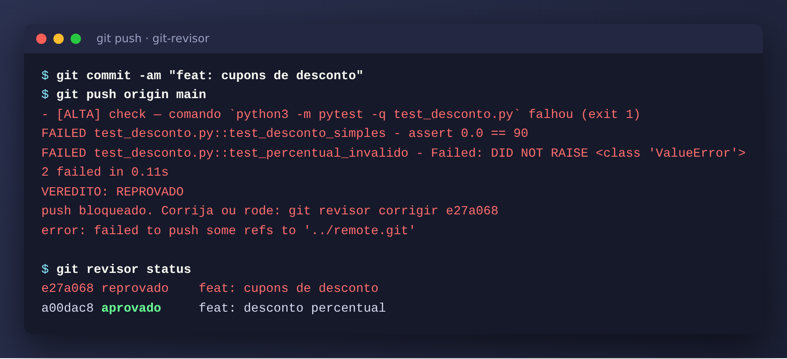

# git-revisor

[Português](README.md) · **English**

[](https://github.com/vitorcamillo/git-revisor/actions/workflows/ci.yml)   

`git-revisor` adds automated AI review of commits to Git hooks. It serves developers who want to block defective pushes before sending, and it combines deterministic checks with diff review and isolated worktree fixes.



*git-revisor blocking a push: the tests fail and the commit stays rejected until fixed.*

## Contents

- [Features](#features)
- [Quick start](#quick-start)
- [Usage](#usage)
- [Configuration](#configuration)
- [How it works](#how-it-works)
- [Limitations and responsible use](#limitations-and-responsible-use)
- [Contributing](#contributing)
- [License](#license)

## Features

- Blocks pushes of rejected commits before the defect reaches the remote.
- Runs tests and lint in worktrees of the commit, without touching the working tree.
- Detects test commands of pytest, Maven, npm, Go, and Cargo projects.
- Forwards the fix to an external worker in an isolated worktree when a review fails.
- Submits every fix to the same checks and to a fresh review before accepting it.
- Lets documentation-only and generated-file changes through without calling the AI.
- Exposes state and reports via `git revisor status` for later auditing.

## Quick start

Requirements:

- Linux with Python 3.10 or newer and Git.
- Bash, `readlink`, and `flock` available on the `PATH`.
- External AI wrappers installed and configured on the `PATH`: `codex-ask` as reviewer and, in fallback order, `zcode-worker`, `muse-ask`, `codex-ask`, and `claude-ask` as workers. Wrappers available at [worker-ask-router](https://github.com/vitorcamillo/worker-ask-router).

Clone and prepare the environment:

```bash
git clone https://github.com/vitorcamillo/git-revisor.git
cd git-revisor
python3 -m venv .venv
source .venv/bin/activate
python -m pip install -r requirements-dev.txt
```

To install the hooks and the `git revisor` command:

> **Attention:** `instalar` sets `core.hooksPath` in the global Git configuration and creates links for the hooks and for `~/.local/bin/git-revisor`. If the global `core.hooksPath` already points to another path, the installation stops without overwriting it.

```bash
python3 git_revisor.py instalar
```

Check the installation and the state in the repository:

```bash
export PATH="$HOME/.local/bin:$PATH"
git revisor status
```

To turn off the reviewer only in the current repository:

```bash
git revisor desligar
```

## Usage

All commands use the form `git revisor <subcommand>`, resolved by the `git-revisor` executable installed in `~/.local/bin`.

| Command | Effect |
| --- | --- |
| `revisar <sha>` | Reviews the commit (and the pending batch) immediately. |
| `revisar-adiado <sha>` | Waits for the debounce interval and reviews, skipping commits already covered by a newer commit. |
| `corrigir <sha>` | Runs the worker fix flow in the foreground. |
| `corrigir-push <sha>` | Runs the fix of a push in the background. |
| `retentar-push <sha>` | Waits for the machine to become free and resends a push held for infra or lock reasons. |
| `suite-completa <sha>` | Runs the full suite of the tree in the background. |
| `pendentes` | Re-reviews the commits left inconclusive. |
| `status [<sha>]` | Shows the repository summary or the report of one commit. |
| `ligar` | Enables the reviewer in this repository (`revisor.enabled=true`). |
| `desligar` | Disables the reviewer in this repository (`revisor.enabled=false`). |
| `instalar` | Installs the global hooks and the `git-revisor` command. |
| `desinstalar` | Removes the hooks and the command created by `instalar`. |
| `limpar` | Archives the `revisor/*` branches and deletes old attempts. |

Examples:

```bash
git revisor revisar HEAD
git revisor status
git revisor status abc1234
REVISOR_PULAR=1 git push
```

## Configuration

The external AI commands can be overridden with `REVISOR_CMD_*` environment variables. Do not store tokens or secrets in versioned files.

| Variable | Default | Effect |
| --- | --- | --- |
| `REVISOR_CMD_REVISAR` | `codex-ask` | Reviewer that analyzes the diff. |
| `REVISOR_CMD_WORKER` | `zcode-worker --model GLM-5.3 --effort max --timeout 1500` | First worker in the fix chain. |
| `REVISOR_CMD_WORKER_MUSE` | `muse-ask --model muse-wonder-1.0 --effort max --timeout 1500` | Next worker in the fix chain. |
| `REVISOR_CMD_GITLEAKS` | `gitleaks` | Secret detector; without it on the `PATH`, pre-push proceeds. |
| `REVISOR_PULAR` | — | With `1`, sends the push without review. |
| `REVISOR_SEM_CORRECAO` | — | With `1`, the internal push does not fix again. |
| `REVISOR_TEMPO_REVISOR` | `1500` | Timeout in seconds for reviewer calls. |
| `REVISOR_TEMPO_WORKER` | `1800` | Timeout in seconds for worker calls. |

Deterministic checks and per-repository behavior come from the local Git configuration (`git config`). Without `revisor.check` configured, automatic detection looks for pytest, Maven, npm, Go, and Cargo projects.

| Key | Default | Effect |
| --- | --- | --- |
| `revisor.enabled` | `true` | With `false`, turns everything off in this repository. |
| `revisor.check` | — | Deterministic commands (multiple values), run in a worktree of the commit; a failure rejects the change. |
| `revisor.checkTimeout` | `1200` | Seconds per check command. |
| `revisor.checkRapido` | `true` | Fast filter before the AI; with `false`, the filter is off. |
| `revisor.checkFinal` | `completo` | With `selecionado`, the final check runs only the tests linked to the diff. |
| `revisor.autoCheck` | `true` | With `false`, turns off automatic test detection. |
| `revisor.ordem` | `ia-primeiro` | With `check-primeiro`, the full check runs before the AI. |
| `revisor.autopush` | `false` | With `true`, pushes automatically after approving or applying the fix. |
| `revisor.segundoPlano` | `false` | With `true`, each commit is reviewed when created; otherwise, only on push. |
| `revisor.baixoRisco` / `revisor.altoRisco` | — | Extra globs added to the built-in risk triage lists. |
| `revisor.rodadas` | `2` | Maximum worker fix attempts. |

Examples:

```bash
git config --add revisor.check "pytest -q"
git config revisor.checkTimeout 600
git config revisor.checkFinal selecionado
git config revisor.autopush true
```

## How it works

- The commit and push hooks call the reviewer. On push, commits not yet approved are reviewed before sending; a rejection blocks the push.
- Deterministic checks, such as tests and lint, run in worktrees of the commit. By default, the project tries to detect known tests; commands can also be configured per repository. A failing check rejects the change.
- Changes classified as low risk may pass without AI review, but the configured or detected checks still apply.
- When a review fails, the worker prepares an isolated fix in a worktree. The fix also goes through the checks and an independent review before being accepted.
- Pre-push also blocks sending when `gitleaks` finds a possible secret in the push history.
- Acceptance criteria: an `Aceite:` section in the commit message body (header alone on its line, items `1.`, `1)`, `-` or `*`, a blank line ends it) is handed to the AI reviewer. A criterion not met by the diff fails the push, and the report shows `ACEITE: met/total`. Limits: a low-risk-only change does not go through the AI, and in a diff split into several parts a final check verifies in the repository the criteria that no part failed.
- Commits too large for automatic review require manual review. Run `git revisor status` to see the state and the available reports.

## Limitations and responsible use

- git-revisor depends on the external wrappers for AI review and fixing: it provides no free local models and does not work without an available external reviewer.
- Usage may send diffs and repository context to the configured provider and may incur costs depending on that provider's account, model, and policies. Check the privacy and billing terms before enabling the hooks.
- Automatic decisions do not replace human review. Inspect the diff, the check results, and any proposed fix before treating the change as ready.
- Changes too large for automatic review are not approved by the tool; review manually or send with `REVISOR_PULAR=1 git push`.
- The configuration is local to the repository and may run the project's own commands in the worktrees. Review those commands before enabling checks on code you do not know.
- Before publishing logs, reports, or diffs, remove tokens, private URLs, client names, and personal data.

## Contributing

Contributions are welcome: see [CONTRIBUTING.md](CONTRIBUTING.md) to set up the environment, run the suite with `python -m pytest -q`, and open issues and pull requests.

## License

Distributed under the [MIT license](LICENSE).
