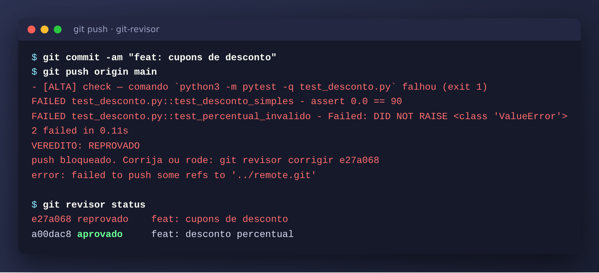

# git-revisor

**Português** · [English](README.en.md)

[](https://github.com/vitorcamillo/git-revisor/actions/workflows/ci.yml)   

O `git-revisor` adiciona revisão automatizada de commits por IA aos hooks do Git. Ele atende desenvolvedores que querem barrar pushes com defeito antes de enviar, e combina checks determinísticos com revisão de diff e correção isolada em worktree.



*O git-revisor barrando um push: os testes falham e o commit fica reprovado até ser corrigido.*

## Sumário

- [Recursos](#recursos)
- [Início rápido](#início-rápido)
- [Uso](#uso)
- [Configuração](#configuração)
- [Como funciona](#como-funciona)
- [Limitações e uso responsável](#limitações-e-uso-responsável)
- [Contribuição](#contribuição)
- [Licença](#licença)

## Recursos

- Bloqueia o push de commits reprovados antes que o defeito chegue ao remoto.
- Roda testes e lint em worktrees do commit, sem tocar na árvore de trabalho.
- Detecta comandos de teste de projetos pytest, Maven, npm, Go e Cargo.
- Encaminha a correção a um worker externo em worktree isolado quando há reprovação.
- Submete toda correção aos mesmos checks e a uma nova revisão antes de aceitar.
- Libera mudanças só de documentação e arquivos gerados sem chamar a IA.
- Expõe estado e relatórios por `git revisor status` para auditoria posterior.

## Início rápido

Requisitos:

- Linux com Python 3.10 ou mais recente e Git.
- Bash, `readlink` e `flock` disponíveis no `PATH`.
- Wrappers externos de IA instalados e configurados no `PATH`: `codex-ask` como revisor e, em sequência de fallback, `zcode-worker`, `muse-ask`, `codex-ask` e `claude-ask` como workers. Wrappers disponíveis em [worker-ask-router](https://github.com/vitorcamillo/worker-ask-router).

Clone e prepare o ambiente:

```bash
git clone https://github.com/vitorcamillo/git-revisor.git
cd git-revisor
python3 -m venv .venv
source .venv/bin/activate
python -m pip install -r requirements-dev.txt
```

Para instalar os hooks e o comando `git revisor`:

> **Atenção:** `instalar` configura `core.hooksPath` na configuração global do Git e cria links para os hooks e para `~/.local/bin/git-revisor`. Se `core.hooksPath` global já estiver configurado para outro caminho, a instalação para sem sobrescrevê-lo.

```bash
python3 git_revisor.py instalar
```

Confira a instalação e o estado no repositório:

```bash
export PATH="$HOME/.local/bin:$PATH"
git revisor status
```

Para desligar o revisor apenas no repositório atual:

```bash
git revisor desligar
```

## Uso

Todos os comandos usam a forma `git revisor <subcomando>`, resolvida pelo executável `git-revisor` instalado em `~/.local/bin`.

| Comando | Efeito |
| --- | --- |
| `revisar <sha>` | Revisa o commit (e o lote pendente) imediatamente. |
| `revisar-adiado <sha>` | Aguarda o debounce e revisa, ignorando commits já cobertos por um commit mais novo. |
| `corrigir <sha>` | Executa o fluxo de correção do worker em primeiro plano. |
| `corrigir-push <sha>` | Executa a correção de um push em segundo plano. |
| `retentar-push <sha>` | Aguarda a máquina liberar e reenvia um push segurado por infra ou lock. |
| `suite-completa <sha>` | Roda a suíte completa da árvore em segundo plano. |
| `qa <sha>` | Roda o QA cliente de um sha já empurrado. |
| `pendentes` | Re-revisa os commits que ficaram inconclusivos. |
| `status [<sha>]` | Mostra o resumo do repositório ou o relatório de um commit. |
| `ligar` | Ativa o revisor neste repositório (`revisor.enabled=true`). |
| `desligar` | Desativa o revisor neste repositório (`revisor.enabled=false`). |
| `instalar` | Instala os hooks globais e o comando `git-revisor`. |
| `desinstalar` | Remove os hooks e o comando criados pelo `instalar`. |
| `limpar` | Arquiva as branches `revisor/*` e apaga tentativas antigas. |

Exemplos:

```bash
git revisor revisar HEAD
git revisor status
git revisor status abc1234
REVISOR_PULAR=1 git push
```

## Configuração

Os comandos externos de IA podem ser substituídos por variáveis de ambiente `REVISOR_CMD_*`. Não coloque tokens ou segredos em arquivos versionados.

| Variável | Padrão | Efeito |
| --- | --- | --- |
| `REVISOR_CMD_REVISAR` | `codex-ask` | Revisor que analisa o diff. |
| `REVISOR_CMD_WORKER` | `zcode-worker --model GLM-5.3 --effort max --timeout 1500` | Primeiro worker da cadeia de correção. |
| `REVISOR_CMD_WORKER_MUSE` | `muse-ask --model muse-wonder-1.0 --effort max --timeout 1500` | Worker seguinte na cadeia de correção. |
| `REVISOR_CMD_GITLEAKS` | `gitleaks` | Detector de segredos; sem ele no `PATH`, o pre-push segue. |
| `REVISOR_PULAR` | — | Com `1`, envia o push sem revisão. |
| `REVISOR_SEM_CORRECAO` | — | Com `1`, o push interno não corrige de novo. |
| `REVISOR_TEMPO_REVISOR` | `1500` | Timeout em segundos das chamadas ao revisor. |
| `REVISOR_TEMPO_WORKER` | `1800` | Timeout em segundos das chamadas ao worker. |

Os checks determinísticos e o comportamento por repositório saem da configuração local do Git (`git config`). Sem `revisor.check` configurado, a detecção automática procura projetos pytest, Maven, npm, Go e Cargo.

| Chave | Padrão | Efeito |
| --- | --- | --- |
| `revisor.enabled` | `true` | Com `false`, desliga tudo neste repositório. |
| `revisor.check` | — | Comandos determinísticos (vários valores), rodados em worktree do commit; falha reprova a mudança. |
| `revisor.checkTimeout` | `1200` | Segundos por comando de check. |
| `revisor.checkRapido` | `true` | Filtro rápido antes da IA; com `false`, o filtro é desligado. |
| `revisor.checkFinal` | `completo` | Com `selecionado`, o check final roda só os testes ligados ao diff. |
| `revisor.autoCheck` | `true` | Com `false`, desliga a detecção automática de testes. |
| `revisor.ordem` | `ia-primeiro` | Com `check-primeiro`, o check completo roda antes da IA. |
| `revisor.autopush` | `false` | Com `true`, empurra sozinho após aprovar ou aplicar a correção. |
| `revisor.segundoPlano` | `false` | Com `true`, cada commit é revisado ao ser criado; senão, só no push. |
| `revisor.baixoRisco` / `revisor.altoRisco` | — | Globs extras que se somam às listas internas de triagem por risco. |
| `revisor.rodadas` | `2` | Máximo de tentativas de correção do worker. |

Exemplos:

```bash
git config --add revisor.check "pytest -q"
git config revisor.checkTimeout 600
git config revisor.checkFinal selecionado
git config revisor.autopush true
```

## Como funciona

- Os hooks de commit e push chamam o revisor. No push, os commits ainda não aprovados são revisados antes do envio; uma reprovação bloqueia o push.
- Checks determinísticos, como testes e lint, rodam em worktrees do commit. Por padrão, o projeto tenta detectar testes conhecidos; também é possível configurar comandos por repositório. Uma falha de check reprova a mudança.
- Mudanças classificadas como baixo risco podem passar sem revisão de IA, mas os checks configurados ou detectados continuam sendo considerados.
- Quando há reprovação, o worker prepara uma correção isolada em worktree. A correção também passa pelos checks e por uma revisão independente antes de ser aceita.
- O pre-push também bloqueia o envio quando o `gitleaks` encontra possível segredo no histórico do push.
- Critérios de aceite: uma seção `Aceite:` no corpo da mensagem do commit (cabeçalho sozinho na linha, itens `1.`, `1)`, `-` ou `*`, linha em branco encerra) é entregue ao revisor de IA. Critério não atendido pelo diff reprova o push e o relatório traz `ACEITE: atendidos/total`. Limites: mudança só de baixo risco não passa pela IA, e em diff dividido em várias partes uma conferência final confere no repositório os critérios que nenhuma parte reprovou.
- Commits grandes demais para revisão automática exigem revisão manual. Consulte `git revisor status` para ver o estado e os relatórios disponíveis.

## QA cliente

Após um push aprovado, o revisor pode rodar um QA que usa o produto como cliente (navegador sem janela, API, erros forçados). Ele lê os critérios `Aceite:` dos commits e devolve achados com prova; um verificador independente reexecuta as provas e só o confirmado vale. Nunca bloqueia o push e é opt-in por repositório.

Para ligar, configure e commite o roteiro (alvos e jornadas a percorrer):

```bash
git config revisor.qa true
```

Opcional: `.revisor/qa-armadilhas.md` versionado lista falsos positivos conhecidos; o QA aprende outros sozinho em `.git/revisor/qa/armadilhas.md`.

| Variável | Padrão | Efeito |
| --- | --- | --- |
| `REVISOR_CMD_QA` | `codex-ask --mode qa` | Agente que usa o produto como cliente. |
| `REVISOR_CMD_QA_VERIFICAR` | `claude-ask --mode qa` | Verificador independente das provas. |
| `REVISOR_QA_TIMEOUT` | `1500` | Timeout em segundos de cada chamada do QA. |
| `REVISOR_QA_ESPERA` | `1200` | Teto em segundos da espera pelo remoto e pelo `revisor.qaPronto`. |
| `REVISOR_QA_INTERVALO` | `20` | Intervalo em segundos entre sondagens da espera. |
| `REVISOR_QA_RODADAS` | `2` | Limite de rodadas de correção automática por cadeia. |
| `REVISOR_QA` | — | Com `0`, desliga o QA mesmo configurado. |

Limites conhecidos: uma execução por repositório (push novo encerra a anterior de outro sha); `revisor.qaPronto` (linha de shell rodada em `sh -c` com `REVISOR_QA_SHA`, exit 0 libera) segura o QA até o ambiente ficar pronto; sem correção automática por padrão — `git config revisor.qaCorrigir true` liga (a correção passa por revisão e novo QA, até o limite de rodadas); só achado BAIXA confirmado vai para `.git/revisor/qa/baixa.md`, sem notificar.

As proibições do QA (pagamento, senha ou dado pessoal fora de host local, CAPTCHA, site de terceiros) valem por prompt e por rodar em diretório vazio, não por bloqueio de rede. Fluxo logado ainda não recebe credencial de teste. A correção automática (`revisor.qaCorrigir`) tem só teste unitário, sem prova ao vivo.


## Limitações e uso responsável

- O git-revisor depende dos wrappers externos para revisão e correção por IA: não fornece modelos locais gratuitos nem funciona sem um revisor externo disponível.
- O uso pode enviar diffs e contexto do repositório ao provedor configurado e pode gerar custos conforme a conta, o modelo e as políticas desse provedor. Verifique as condições de privacidade e cobrança antes de habilitar os hooks.
- As decisões automáticas não substituem a revisão humana. Confira o diff, os resultados dos checks e qualquer correção proposta antes de considerar a mudança pronta.
- Mudanças grandes demais para revisão automática não são aprovadas pela ferramenta; revise manualmente ou envie com `REVISOR_PULAR=1 git push`.
- A configuração é local ao repositório e pode executar comandos do próprio projeto nos worktrees. Revise esses comandos antes de habilitar checks em código que não conhece.
- Antes de publicar logs, relatórios ou diffs, remova tokens, URLs privadas, nomes de clientes e dados pessoais.

## Contribuição

Contribuições são bem-vindas: veja [CONTRIBUTING.md](CONTRIBUTING.md) para preparar o ambiente, executar a suíte com `python -m pytest -q` e abrir issues e pull requests.

## Licença

Distribuído sob a [licença MIT](LICENSE).
